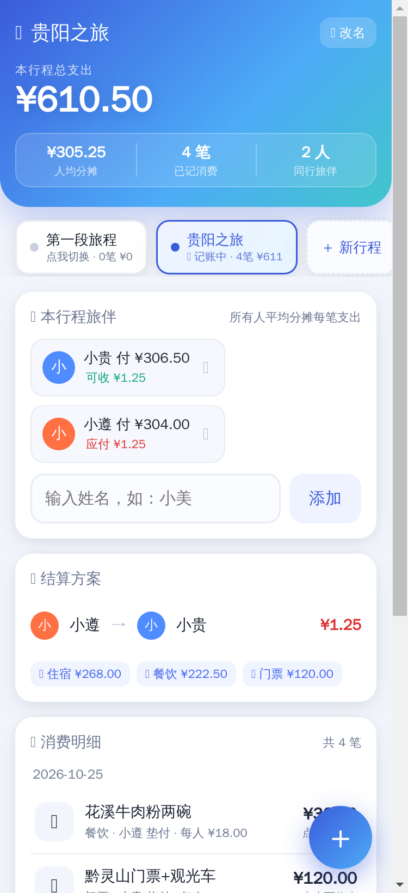

# 旅行 AA 记账（travel-split）

多人旅行同行记账网页：按**行程**分账，每笔支出在该行程所有旅伴间**自动平分**，
实时生成**精确到分的互转账结算方案**。零依赖、单文件前端、多设备自动同步，适合 NAS / 小服务器常驻。

> 部署形态提示：本项目是**自托管 Web 服务**（HTTP，无 HTTPS），请自行准备一台有公网
> （或局域网）地址的机器运行。无账号体系与鉴权，请勿暴露给不可信网络。

## 功能

| 模块 | 说明 |
|---|---|
| 多行程 | 顶部行程条新建/切换/重命名/删除（至少保留一段）；旅伴与账目按行程完全隔离 |
| 旅伴 | 每段行程最多 8 人；有垫付记录的旅伴不可删除，删人后份额自动重算 |
| 记一笔 | 事项、金额（两位小数）、付款人、分类（🍜🏨🚄🎫🛍🎡📦）、日期；点任意记录可改可删 |
| 付款人记忆 | 每台设备浏览器各自记住上次所选付款人（localStorage），下次记账默认选中 |
| 结算 | 每人显示已垫付 / 可收 / 应付；自动生成最简转账方案；分类小计 |
| 多端同步 | 各设备 2s 轮询 `GET /api/state`，命令响应即带回最新状态，无需手动刷新 |

## 平分与结算逻辑（服务端唯一实现：`compute_summary()`）

1. 所有金额以**整数「分」**存储与计算，杜绝浮点误差；
2. 人均份额 = 总额 ÷ 人数 向下取整；余下的 N 分按「垫付多者优先」每人 +1 分，恒有 **Σ份额 = 总额**；
3. 每人余额 = 已垫付 − 应分摊，全员余额和恒为 0；
4. 转账方案：债务人/债权人各按金额降序贪心精确匹配，转出总额 = 债务总额，无尾差。

## 快速开始

```bash
python3 server.py --host :: --port 8090   # 双栈监听（IPv6 + IPv4 同端口）
# 打开 http://<你的主机地址>:8090/ 即可使用
```

要求：Python ≥ 3.8，仅标准库。前端为 `static/index.html` 单文件，不引用任何 CDN，断网内网可用。

常驻部署（systemd，可选）：

```ini
[Unit]
Description=Travel AA Ledger
After=network-online.target

[Service]
WorkingDirectory=/opt/travel-split
ExecStart=/usr/bin/python3 /opt/travel-split/server.py --host :: --port 8090
Restart=always

[Install]
WantedBy=multi-user.target
```

## HTTP API

- `GET /api/state` → `{ok, state, tripId, summary}`（`summary` 恒为当前行程）
- `POST /api/cmd` → JSON 命令，返回 `{ok, msg, state, tripId, summary}`

| 类别 | type | 关键参数 |
|---|---|---|
| 行程 | `add_trip` | `name`（新建即切入当前） |
| | `switch_trip` / `rename_trip` / `delete_trip` | `id`（rename 可带 `startDate`/`endDate`） |
| 旅伴 | `add_person` / `remove_person` | `name` / `id` |
| 账目 | `add_expense` | `item` `amount` `payerId` `cat` `date` |
| | `edit_expense` / `delete_expense` | `id` + 可选字段 |
| 清理 | `clear_expenses` | 只清当前行程消费，旅伴保留 |

账目类命令**只作用于当前行程**，跨行程 id 一律拒绝。数据原子落盘（tmp → fsync → replace）
为 `data.json`；损坏文件自动留档为 `.corrupt-*`，旧版单行程结构自动迁移为多行程并留档。

## 技术栈

Python 标准库 `http.server`（ThreadingHTTPServer + `AF_INET6` 双栈）· 原生 JS 单文件前端 · 无数据库。

## 目录

```
travel-split/
├── server.py            # 全部业务规则与 HTTP 服务（约 480 行）
├── static/index.html    # 前端单文件（内嵌 CSS/JS，移动端优先）
├── docs/                # 演示截图
├── CHANGELOG.md
└── LICENSE              # MIT
```

## 界面预览



（截图为演示数据，非真实账目。）
